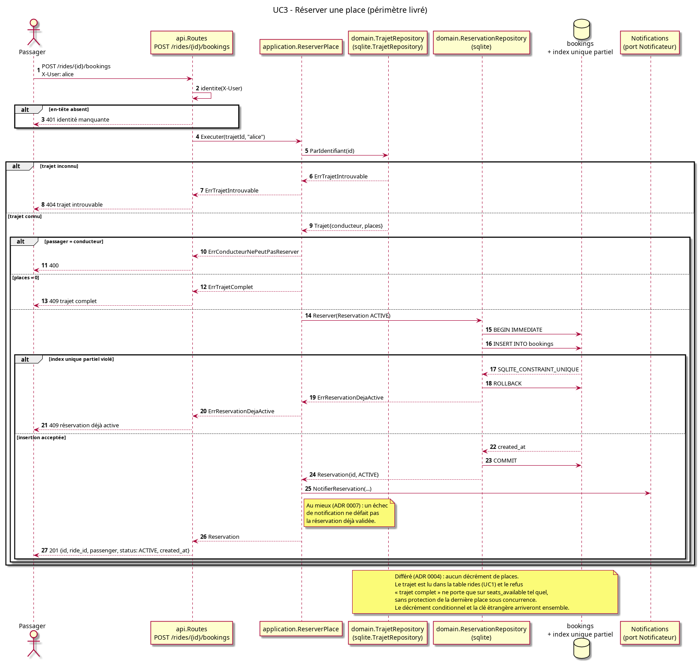
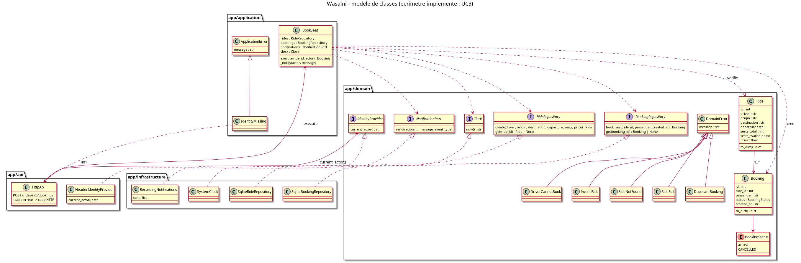

# Architecture - Wasalni (covoiturage interurbain)

Document d'architecture du système décrit dans [vision.md](vision.md) et [use-case-elaboration.md](use-case-elaboration.md).
Il décrit uniquement le service Go : l'implémentation Python de UC3 a été retirée du dépôt et n'est plus une
référence. Seul UC8 (gérer son profil) est implémenté, et les décisions structurantes sont tracées en ADR (§16).

## 1. Périmètre et objectifs

- **Périmètre fonctionnel :** les 12 cas d'utilisation de la vision. Deux sont livrés : UC8 (gérer son profil) et UC3
  (réserver une place) dans un périmètre réduit — les réservations sont écrites, mais le compteur de places appartient
  encore à UC1/UC2 (§15).
- **Objectifs d'architecture :**
  1. isoler les règles métier du transport (HTTP) et de la persistance (SQLite) ;
  2. garder le risque technique du projet — la réservation concurrente — isolé à un seul endroit : l'unicité des
     réservations est aujourd'hui garantie par la base, le décrément atomique des places reste différé (ADR 0004) ;
  3. laisser une place explicite aux systèmes externes (authentification, notification) sans les simuler dans le domaine ;
  4. rendre l'ajout des UC restants mécanique : un cas d'utilisation = un fichier dans `internal/application`, plus des
     ports existants.
- **Hors périmètre :** interface web, validation externe différée, messagerie temps réel, déploiement multi-instance.

## 2. Contraintes

| Contrainte | Conséquence sur la conception |
|---|---|
| Aucune infrastructure serveur (cadre du TP) | un binaire unique, un fichier SQLite, lancement par `go run ./cmd/wasalni` |
| Aucune chaîne de compilation C en CI | pilote `modernc.org/sqlite`, pur Go, sans cgo (ADR 0005, ADR 0009) |
| Dépendances limitées à la bibliothèque standard et à `modernc.org/sqlite` | routage `net/http`, JSON `encoding/json`, images `image` et `image/png`, journaux `log/slog` (ADR 0009) |
| Identité fournie par un système externe | en-tête `X-User`, aucune session, aucun mot de passe (ADR 0002) |
| Photo stockée en base, poids borné | pipeline PNG sans perte, 512 px et 512 Kio au plus (ADR 0008) |
| Documents et messages en français, contrat HTTP en anglais | erreurs métier en français, clés JSON en anglais (`name`, `age`, `sex`, `photo`) |

## 3. Vue de contexte

| Élément | Rôle vis-à-vis du système |
|---|---|
| Client (interface web en français, non livrée) | appelle l'API HTTP et transporte l'identité dans l'en-tête `X-User` |
| Système d'authentification (externe) | émet l'identité ; le service ne stocke aucun mot de passe et n'émet aucun jeton |
| Système de notification (externe) | recevra la confirmation de réservation ; le service n'a aujourd'hui qu'un adaptateur de journal (ADR 0007) |
| Fichier SQLite | persistance locale des profils ; les tables des autres UC n'existent pas encore |

Le service ne dialogue jamais directement avec un utilisateur : tout passe par l'API. L'identité entre par l'en-tête et
reste une donnée de confiance (ADR 0002).

## 4. Vue des conteneurs

| Conteneur | Contenu | Dépend de |
|---|---|---|
| `cmd/wasalni` | binaire HTTP unique : racine de composition, serveur `net/http`, arrêt propre | les paquets `internal/...`, le fichier SQLite |
| `internal/api` | routeur `net/http` (`GET /health`, `GET /profile`, `PUT /profile`, `POST /rides/{id}/bookings`), lecture de `X-User`, décodage JSON, table erreur → code HTTP, borne du corps | `internal/application`, `internal/domain` |
| `internal/application` | cas d'utilisation UC8 `GererProfil` et UC3 `ReserverPlace` | `internal/domain` |
| `internal/domain` | entités `Profil`, `Trajet`, `Reservation`, règles de validation, erreurs, ports | bibliothèque standard seule |
| `internal/infrastructure/sqlite` | ouverture de la base, pragmas, schéma, adaptateur du port de persistance | `internal/domain`, `database/sql`, `modernc.org/sqlite` |
| `internal/infrastructure/photos` | normalisation de la photo : décodage, réduction, encodage PNG | bibliothèque standard seule |
| `internal/infrastructure/notifications` | adaptateur du port `Notificateur` : une ligne de journal par réservation | `internal/domain`, `log/slog` |
| Fichier SQLite | table `users` | — |

Il n'y a ni file d'attente, ni cache, ni service tiers dans le chemin d'une requête : un appel HTTP traverse l'adaptateur,
le cas d'utilisation, puis la base.

## 5. Découpage en couches

Dépendances strictement orientées vers l'intérieur : `api` → `application` → `domain`, et `infrastructure` → `domain`
(elle implémente les ports déclarés en amont).

| Couche | Paquet | Responsabilité | Ne connaît pas |
|---|---|---|---|
| Domaine | `internal/domain` | entité `Profil`, type `Sexe`, bornes et invariants (`Profil.Valider`), erreurs sentinelles, **déclaration du port** `ProfilRepository` | `net/http`, `database/sql` |
| Application | `internal/application` | cas d'utilisation UC8 `GererProfil` (`Consulter`, `Enregistrer`), `SaisieProfil`, port secondaire `NormaliseurPhoto` | HTTP, SQL |
| Infrastructure | `internal/infrastructure/sqlite`, `internal/infrastructure/photos` | adaptateur du port de persistance (schéma, transactions, horodatages) et pipeline d'image | HTTP |
| Interface | `internal/api` | routage, extraction de l'identité, décodage JSON, correspondance erreur → code HTTP | SQL, règles métier |
| Composition | `cmd/wasalni/main.go` | racine de composition : ouvre la base, câble le cas d'utilisation et le normaliseur, sert HTTP, arrête proprement | — |

Règles de dépendance vérifiables à la lecture des imports :

- `internal/domain` n'importe que la bibliothèque standard.
- `internal/application` importe `internal/domain` uniquement.
- `internal/infrastructure/sqlite` importe `internal/domain`, `database/sql` et `modernc.org/sqlite` ;
  `internal/infrastructure/photos` n'importe que la bibliothèque standard.
- `internal/api` importe `internal/application` et `internal/domain` seulement ; il ne connaît ni `internal/infrastructure/sqlite`
  ni `internal/infrastructure/photos` : la borne du corps lui appartient (`api.TailleMaxCorps`) et les erreurs du pipeline
  sont retraduites par le cas d'usage en `application.ErrPhotoInvalide`.
- `internal/` interdit l'import de ces paquets depuis l'extérieur du module.

## 6. Vue des composants


Source : [uml/architecture-components.puml](uml/architecture-components.puml).

Chaîne nominale d'UC8 : `Routes` (`internal/api`) → `GererProfil` (`internal/application`) → port `ProfilRepository`
→ `sqlite.ProfilRepository` → table `users`. La photo traverse `NormaliseurPhoto` → `photos.Normaliser`.

Chaîne nominale d'UC3 : `Routes` → `ReserverPlace` → port `TrajetRepository` (lecture de la vue `Trajet`) puis port
`ReservationRepository` → `sqlite.ReservationRepository` → table `bookings`, sous l'index unique partiel ; enfin le port
`Notificateur` → `notifications.Journal`. La racine de composition fournit un adaptateur de trajets **provisoire**, qui
répond `trajet introuvable` pour tout identifiant et l'annonce au démarrage : la table `rides` n'existe pas encore.

Identité : `Routes` → `identite` (`internal/api/identite.go`), qui lit `X-User` et rend `ErrIdentiteManquante` si
l'en-tête est absent (ADR 0002).

## 7. Ports et adaptateurs

| Port | Déclaré dans | Contrat | Adaptateur |
|---|---|---|---|
| `domain.ProfilRepository` | `internal/domain/ports.go` | `Enregistrer(ctx, Profil) (Profil, bool, error)` (le booléen vaut vrai à la création), `ParIdentifiant(ctx, identifiant) (Profil, error)` | `internal/infrastructure/sqlite/profil_repository.go` |
| `application.NormaliseurPhoto` | `internal/application/gerer_profil.go` | `Normaliser(photoBase64 string) (string, error)` | `internal/infrastructure/photos/pipeline.go` (`Normaliser`), adapté par `normaliseurPhoto` dans `cmd/wasalni/main.go` |
| `domain.TrajetRepository` | `internal/domain/ports.go` | `ParIdentifiant(ctx, identifiant) (Trajet, error)` | provisoire : `trajetsProvisoires` dans `cmd/wasalni/main.go` (rend `ErrTrajetIntrouvable`) ; la vraie lecture arrive avec UC1/UC2 |
| `domain.ReservationRepository` | `internal/domain/ports.go` | `Reserver(ctx, Reservation) (Reservation, error)` ; échoue avec `ErrReservationDejaActive` si une réservation `ACTIVE` existe pour le couple (trajet, passager). `ParPassager(ctx, passager) ([]Reservation, error)` liste les réservations d'un passager, les deux états compris, de la plus récente à la plus ancienne | `internal/infrastructure/sqlite/reservation_repository.go` |
| `application.Notificateur` | `internal/application/reserver_place.go` | `NotifierReservation(ctx, Reservation) error`, au mieux (ADR 0007) | `internal/infrastructure/notifications/journal.go` |

- `ProfilRepository` est déclaré par le domaine : l'entité `Profil` y vit et le cas d'utilisation en dépend directement.
- `NormaliseurPhoto` est déclaré par l'application, pas par le domaine : le format d'image est un détail technique, le
  domaine ne connaît que `Profil.Photo`, une chaîne base64 d'un PNG déjà normalisé.
- L'identité n'est pas un port : c'est une fonction de l'adaptateur HTTP. Un port pour un seul adaptateur et sans second
  implémentation réelle serait une abstraction spéculative (ADR 0001, ADR 0002).
- Un port n'est ajouté que s'il a un système externe derrière lui ou deux implémentations réelles (l'adaptateur SQLite et
  un faux dans les tests).

## 8. Contrat HTTP

Toutes les routes sont construites par `api.Routes` (`internal/api/routes.go`). Les motifs de méthode de `net/http`
(`"GET /profile"`) portent la méthode et le chemin.

| Méthode | Chemin | En-tête | Corps de requête | Réponses |
|---|---|---|---|---|
| `GET` | `/health` | — | — | `200` `{"statut":"ok"}` |
| `GET` | `/profile` | `X-User` requis | — | `200` profil, `401` identité absente, `404` profil introuvable, `500` erreur inattendue |
| `PUT` | `/profile` | `X-User` requis | `{name, age, sex?, photo?}` | `201` création, `200` mise à jour, `400` saisie ou image refusée, `401` identité absente, `413` corps trop volumineux, `500` erreur inattendue |
| `POST` | `/rides/{id}/bookings` | `X-User` requis | — | `201` réservation `ACTIVE`, `400` conducteur ou trajet invalide, `401` identité absente, `404` trajet inconnu, `409` trajet complet ou réservation déjà active, `500` erreur inattendue |

Corps de requête (`SaisieProfil`) :

```json
{"name": "Amine", "age": 24, "sex": "MALE", "photo": "data:image/png;base64,iVBORw0…"}
```

Corps de réponse (`profilJSON`) :

```json
{"id":"amine","name":"Amine","age":24,"sex":"MALE","photo":"iVBORw0…","created_at":"2026-11-24T21:00:00Z","updated_at":"2026-11-24T21:00:00Z"}
```

Règles du corps de requête :

- `name` est découpé de ses espaces puis validé : de 2 à 80 caractères. `age` : de 18 à 99.
- `sex` accepte `MALE`, `FEMALE`, `OTHER` ou l'absence ; la valeur est découpée et passée en majuscules avant validation.
- `photo` absent ou `null` : la photo existante est conservée. `""` : la photo est effacée. Toute autre valeur est
  normalisée (§10) avant l'enregistrement.
- Les champs inconnus sont refusés (`DisallowUnknownFields`) et un corps illisible donne `400` avec
  `{"error":"corps JSON invalide"}`.
- Le corps est limité à 10 Mio (`api.TailleMaxCorps` via `http.MaxBytesReader`) ; au-delà, `413`.
- `id` n'est jamais fourni par le client : il vient de `X-User`. Un appelant ne peut donc lire ou écrire que sa propre
  ligne.

Réservation (`POST /rides/{id}/bookings`) — aucun corps de requête, l'identité suffit. Réponse :

```json
{"id":"0f9c…","ride_id":"t1","passenger":"alice","status":"ACTIVE","created_at":"2026-11-24T21:15:48Z"}
```

Ordre des contrôles : identité (`401`), trajet connu (`404`), trajet exploitable (`400`), passager distinct du
conducteur (`400`), place disponible (`409`), puis écriture ; le doublon éventuel est refusé par l'index unique et rend
`409`. Aucune place n'est décrémentée dans cette version (§15).



Source : [uml/uc3-sequence.puml](uml/uc3-sequence.puml). Le diagramme décrit le comportement **livré** : la note finale
rappelle le décrément différé, il ne doit pas être dessiné comme appliqué tant que la table `rides` n'existe pas.

## 9. Modèle de données

Deux tables, avec le DDL réellement appliqué (`internal/infrastructure/sqlite/schema.go`). Celle de UC8 :

```sql
CREATE TABLE IF NOT EXISTS users (
    id         TEXT PRIMARY KEY,
    name       TEXT NOT NULL,
    age        INTEGER NOT NULL CHECK (age BETWEEN 18 AND 99),
    sex        TEXT CHECK (sex IS NULL OR sex IN ('MALE', 'FEMALE', 'OTHER')),
    photo      TEXT,
    created_at TEXT NOT NULL DEFAULT (strftime('%Y-%m-%dT%H:%M:%SZ', 'now')),
    updated_at TEXT NOT NULL DEFAULT (strftime('%Y-%m-%dT%H:%M:%SZ', 'now'))
);
```

Celle de UC3 :

```sql
CREATE TABLE IF NOT EXISTS bookings (
    id         TEXT PRIMARY KEY,
    ride_id    TEXT NOT NULL,
    passenger  TEXT NOT NULL,
    status     TEXT NOT NULL CHECK (status IN ('ACTIVE', 'CANCELLED')),
    created_at TEXT NOT NULL DEFAULT (strftime('%Y-%m-%dT%H:%M:%SZ', 'now'))
);

CREATE UNIQUE INDEX IF NOT EXISTS bookings_active_unique
    ON bookings (ride_id, passenger) WHERE status = 'ACTIVE';
```

Invariants portés par le schéma ou par le domaine :

- `id` est l'identité fournie par `X-User` : elle est créée par le système externe, jamais par ce service.
- `age` est borné par un `CHECK` (18 à 99), doublé de la validation du domaine : une saisie hors bornes est refusée en
  `400`, pas par la base.
- `sex` est facultatif et vaut `NULL` quand il n'est pas renseigné ; l'adaptateur écrit `NULL` pour la valeur vide.
- `photo` vaut `NULL` quand le profil n'a pas de photo ; sinon, base64 d'un PNG normalisé de 512 Kio au plus.
- `created_at` et `updated_at` sont posés par la base au format RFC 3339 UTC, puis relus par `RETURNING` : le service
  n'horodate pas lui-même.
- Le schéma est idempotent (`CREATE TABLE IF NOT EXISTS`) et appliqué à chaque démarrage ; il n'y a pas de migration
  versionnée.
- `bookings.status` est contraint à `ACTIVE` ou `CANCELLED` (ADR 0003) ; l'index partiel `bookings_active_unique`
  interdit deux réservations `ACTIVE` pour le même couple (trajet, passager), y compris sous appels simultanés.
- `bookings.ride_id` n'a pas de clé étrangère : la table `rides` appartient à UC1/UC2 et n'existe pas encore. C'est une
  dette explicite (§15), pas un oubli.
- Une réservation ne stocke pas le prix ni le nombre de places : le compteur de places est différé avec la table `rides`
  (ADR 0004).

Les tables des autres UC (trajets, évaluations) n'existent pas encore : elles seront ajoutées avec les cas
d'utilisation correspondants (§14).

### Modèle de classes (périmètre implémenté)



Source : [uml/class-model.puml](uml/class-model.puml). Le diagramme décrit le **code livré** : entité `Profil` et ses
bornes, port `ProfilRepository` et son adaptateur SQLite, port `NormaliseurPhoto` et `photos.Normaliser`, cas
d'utilisation `GererProfil` et adaptateur HTTP. Il se maintient avec le code : un diagramme qui diverge de
l'implémentation est un défaut, pas une illustration.

## 10. Pipeline photo

Le pipeline vit dans `internal/infrastructure/photos` et n'utilise que la bibliothèque standard (ADR 0008).

1. **Réception.** La photo arrive en base64 dans le champ `photo`, éventuellement préfixée `data:image/…;base64,`. Le
   corps entier de la requête est limité à **10 Mio** (`TailleMaxCorps = 10 << 20`) avant tout décodage : au-delà, `413`.
2. **Décodage.** Le préfixe de data URL, les espaces, tabulations et retours à la ligne sont retirés, puis la chaîne est
   décodée en base64 (standard ou sans remplissage). `image.Decode` reconnaît PNG, JPEG et GIF, enregistrés par des
   imports anonymes. Une chaîne invalide ou un format inconnu donne `ErrImageIllisible` (`400`).
3. **Réduction.** Le plus grand côté est ramené à **512 px** au plus (`CoteMax`) par moyenne de blocs (box filter) : chaque
   pixel destination est la moyenne des pixels source de son bloc. Le redimensionneur est écrit à la main
   (`internal/infrastructure/photos/couleur.go`), sans dépendance de codec ni de rééchantillonnage. Une image déjà petite
   est conservée telle quelle.
4. **Encodage.** Le résultat est encodé en **PNG sans perte** avec `png.BestCompression`.
5. **Réduction par paliers.** Si le PNG dépasse **512 Kio** (`PoidsMax = 512 << 10`), le côté est réduit de 64 px à chaque
   essai : 512, 448, 384, 320, 256, 192 puis **128 px** (`CoteMin`), et l'image est réencodée jusqu'à tenir sous la limite.
6. **Refus.** À 128 px, si le PNG dépasse encore 512 Kio, la photo est refusée en `ErrImageTropLourde` (`400`). Le refus
   n'intervient donc que lorsque la contrainte est réellement impossible à tenir, jamais à cause du format d'entrée.

Le résultat est stocké tel quel dans `users.photo`, en base64 : le service ne conserve ni fichier ni URL d'image.

## 11. Modèle d'erreurs

Les erreurs métier sont des valeurs sentinelles comparables par `errors.Is` et **ne connaissent pas HTTP**. La
correspondance est la responsabilité de l'adaptateur (`internal/api/http.go`, ADR 0006) :

| Erreur | Origine | Code HTTP |
|---|---|---|
| `application.ErrIdentiteManquante` | adaptation de l'identité (`internal/api/identite.go`) | 401 |
| `domain.ErrProfilIntrouvable` | domaine, propagée par l'adaptateur SQLite | 404 |
| `domain.ErrNomRequis` | domaine (`Profil.Valider`) | 400 |
| `domain.ErrNomInvalide` | domaine | 400 |
| `domain.ErrAgeInvalide` | domaine | 400 |
| `domain.ErrSexeInvalide` | domaine | 400 |
| `application.ErrPhotoInvalide` | application (traduit `photos.ErrImageIllisible` et `photos.ErrImageTropLourde`) | 400 |
| `domain.ErrTrajetIntrouvable` | domaine, propagée par l'adaptateur de trajets | 404 |
| `domain.ErrTrajetComplet` | cas d'usage `ReserverPlace` | 409 |
| `domain.ErrReservationDejaActive` | domaine, traduite depuis la violation d'index unique | 409 |
| `domain.ErrConducteurNePeutPasReserver` | cas d'usage `ReserverPlace` | 400 |
| `domain.ErrTrajetInvalide` | domaine (`Trajet.Valider`, `Reservation.Valider`) | 400 |
| corps JSON invalide ou champ inconnu | adaptateur HTTP | 400 |
| corps supérieur à 10 Mio | adaptateur HTTP (`http.MaxBytesReader`) | 413 |
| toute autre erreur | infrastructure | 500, journalisée, message générique |

La table est unique : la fonction `statutHTTP` de `internal/api/http.go`. Le corps de réponse est toujours
`{"error": "<message>"}` ; pour un `500`, le message est « erreur interne » et la cause réelle part dans les journaux
`log/slog`.

## 12. Stratégie de tests

- **Tests unitaires par paquet**, dans un fichier `_test.go` voisin du code testé et dans le même paquet : les règles de
  `Profil` (nom requis, bornes de longueur et d'âge, sexe facultatif), le cas d'utilisation `GererProfil` avec un faux
  `ProfilRepository` en mémoire et un faux `NormaliseurPhoto`, le pipeline photo sur des images générées, et l'adaptateur
  SQLite (schéma appliqué deux fois sans erreur, création puis mise à jour).
- **Test d'intégration HTTP sur une base temporaire** : le test crée son fichier dans `t.TempDir()`, l'ouvre avec
  `sqlite.Ouvrir`, monte `api.Routes` sur un serveur `httptest` et vérifie le contrat de bout en bout — `401` sans
  en-tête, `400` (nom, âge, image illisible), `201` à la création, `200` à la mise à jour, isolation entre deux valeurs de
  `X-User`, `413` au-delà de 10 Mio.
- **Aucun test ne touche une base réelle** : chaque test crée la sienne et la supprime avec le répertoire temporaire.
- **Tests d'UC3** : cas d'usage avec faux `TrajetRepository`, faux `ReservationRepository` (index unique simulé) et faux
  `Notificateur` — quatre refus, succès, doublon, notification en échec qui ne défait pas la réservation ; adaptateur
  SQLite sur base temporaire — insertion, doublon refusé sans seconde ligne, index partiel qui laisse passer un autre
  passager ; intégration HTTP avec un `TrajetRepository` en mémoire et le vrai adaptateur SQLite — `401`, `400`
  conducteur, `404`, `409` complet, `201`, `409` doublon.
- **Commandes** : `go build ./...`, `go vet ./...`, `go test ./...`, et `go test -race ./...` en local.

## 13. Lancer le service

```bash
go run ./cmd/wasalni                                  # écoute sur :8080, base wasalni.db
go run ./cmd/wasalni -addr :9091 -db /tmp/wasalni.db  # drapeaux
WASALNI_ADDR=:9091 WASALNI_DB=/tmp/wasalni.db go run ./cmd/wasalni   # variables d'environnement
go vet ./... && go test ./...
```

Les drapeaux priment sur les variables d'environnement, qui priment sur les valeurs par défaut. Le fichier de base est
créé s'il n'existe pas (`*.db` est ignoré par Git), les pragmas et le schéma sont appliqués au démarrage, et `SIGINT` ou
`SIGTERM` déclenche un arrêt propre avec un délai de 10 secondes.

```bash
curl -s localhost:8080/health
curl -s -H 'X-User: amine' localhost:8080/profile
curl -s -X PUT -H 'X-User: amine' -H 'Content-Type: application/json' \
     -d '{"name":"Amine","age":24,"sex":"MALE"}' localhost:8080/profile
```

## 14. Correspondance UC → composants

| UC | Cas d'utilisation (Go) | Ports sollicités | État |
|---|---|---|---|
| UC8 | `GererProfil` (`internal/application/gerer_profil.go`) | `ProfilRepository`, `NormaliseurPhoto` | implémenté |
| UC13 | `identite` (`internal/api/identite.go`) : lecture de `X-User` | — | partiel : l'identité est lue, pas vérifiée (système externe) |
| UC3 | `ReserverPlace` (`internal/application/reserver_place.go`) | `TrajetRepository` (provisoire), `ReservationRepository`, `Notificateur` | implémenté, périmètre réduit : pas de décrément de places (ADR 0004, §15) |
| UC12 | `Notificateur` → `notifications.Journal` | — | partiel : la notification existe côté service, le système externe non (ADR 0007) |
| UC1, UC2, UC5, UC6, UC7, UC9, UC10, UC11 | — | — | non implémentés |

## 15. Dette et limites connues

- **Pas de compteur de places.** UC3 écrit des réservations mais ne décrémente rien : la table `rides` appartient à
  UC1/UC2 (#5, #10). Conséquence directe : le refus « trajet complet » s'appuie sur la vue `Trajet` et deux réservations
  simultanées sur la dernière place peuvent aboutir. Le décrément conditionnel et son test de concurrence sont la dette
  suivie par l'issue de suivi de #12 ; le contrat du port `ReservationRepository` ne changera pas (ADR 0004).
- **Adaptateur de trajets provisoire.** `cmd/wasalni/main.go` câble un `TrajetRepository` qui répond `trajet introuvable`
  pour tout identifiant : `POST /rides/{id}/bookings` renvoie donc `404` en service réel tant que la table `rides`
  n'existe pas. Le démarrage écrit un avertissement explicite, et les chemins `201`/`400`/`409` sont prouvés en test.
- **Pas de clé étrangère sur `bookings.ride_id`.** Elle arrivera avec la table référencée ; l'ordre d'écriture n'est donc
  pas garanti par la base aujourd'hui.
- **Photos stockées en base.** `users.photo` contient le PNG en base64 : environ un tiers de surcoût par rapport au
  binaire, et l'image entière est relue et retransmise à chaque `GET /profile`. Acceptable pour une photo par profil, à
  revoir quand UC7 lira le profil du conducteur.
- **Pas de frontend.** L'API est la seule surface ; le recadrage de la photo côté navigateur est prévu plus tard et n'est
  pas implémenté (ADR 0008).
- **Pas d'authentification applicative.** `X-User` est cru sur parole : n'importe quel client connaissant un identifiant
  peut agir en son nom. C'est une hypothèse du sujet, pas un oubli (ADR 0002).
- **SQLite mono-fichier, une connexion.** `SetMaxOpenConns(1)` et `SetMaxIdleConns(1)` sérialisent les accès : une seule
  instance par déploiement, pas de réplication, écritures en file (ADR 0005).
- **Pas de migrations versionnées.** Le schéma est idempotent ; il faudra une stratégie dès qu'`users` évoluera ou que
  UC3 ajoutera ses tables.
- **Coût du pipeline non borné en pixels.** La limite de 10 Mio borne l'entrée, pas le nombre de pixels décodés ni le coût
  du box filter. Une image très grande reste coûteuse en mémoire avant réduction.
- **Deux UC couverts, deux partiellement.** UC8 est complet ; UC3 l'est sauf le compteur de places ; UC12 n'a qu'un
  adaptateur de journal. Les autres cas d'utilisation n'ont ni code ni test ; leur place est réservée dans
  l'architecture (§14), pas dans le schéma.

## 16. Décisions (ADR)

| ADR | Décision | Statut |
|---|---|---|
| [0001](adr/0001-couches-et-ports.md) | Quatre couches en paquets Go, dépendances vers l'intérieur, ports déclarés par le domaine | accepté |
| [0002](adr/0002-identite-externe.md) | Identité fournie par un système externe, lue dans `internal/api/identite.go` | accepté |
| [0003](adr/0003-reservation-deux-etats.md) | Réservation à deux états, `ACTIVE` ou `CANCELLED`, sans étape de confirmation | appliqué |
| [0004](adr/0004-concurrence-sqlite.md) | Concurrence : index unique partiel aujourd'hui, décrément conditionnel différé | partiellement appliqué |
| [0005](adr/0005-persistance-sqlite.md) | SQLite sans ORM via `modernc.org/sqlite`, une connexion, schéma idempotent | accepté |
| [0006](adr/0006-modele-erreurs.md) | Erreurs de domaine sans HTTP, correspondance unique dans l'adaptateur | accepté |
| [0007](adr/0007-notification-au-mieux.md) | Notification au mieux, sans remise en cause de l'écriture | appliqué pour UC3 (adaptateur journal) |
| [0008](adr/0008-photo-profil-png.md) | Photo de profil en PNG sans perte, 512 px et 512 Kio au plus | accepté |
| [0009](adr/0009-choix-go.md) | Go avec `net/http`, `database/sql` et `modernc.org/sqlite` | accepté |
