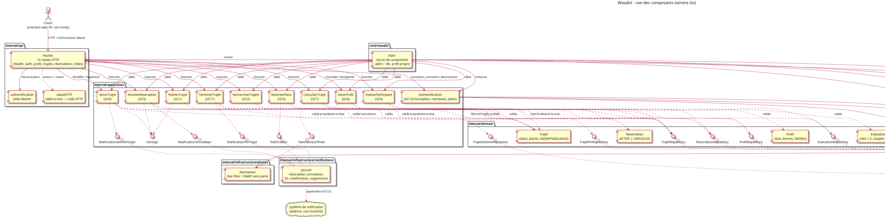
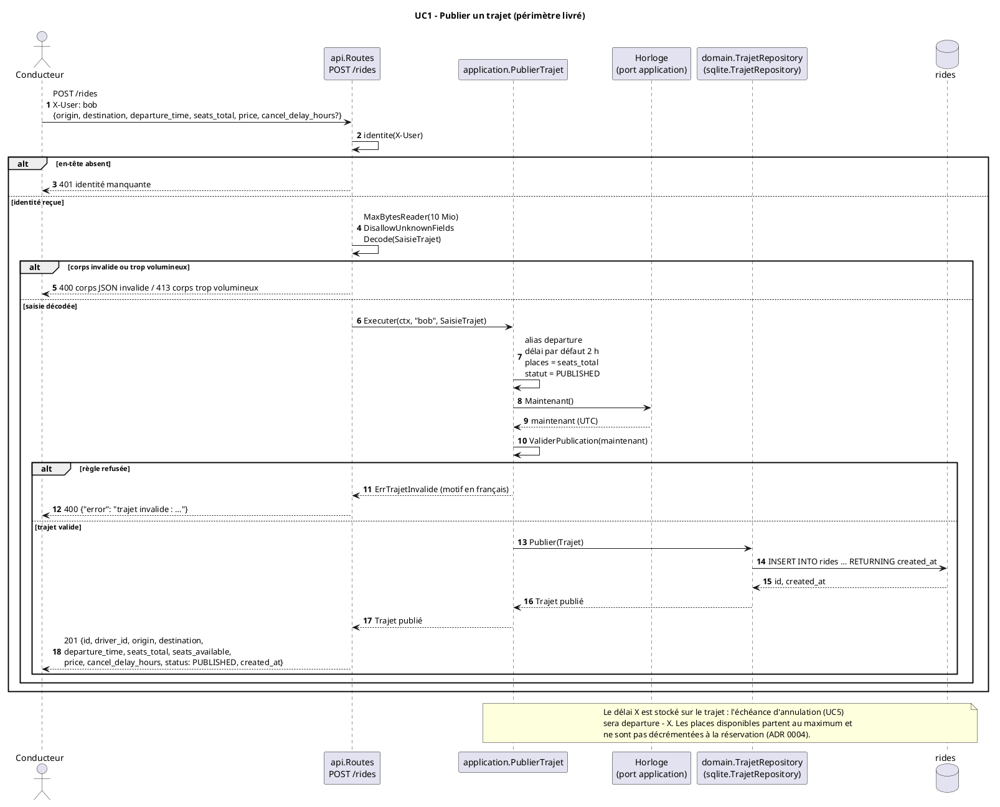

# Architecture - Wasalni (covoiturage interurbain)

Document d'architecture du système décrit dans [vision.md](vision.md) et [use-case-elaboration.md](use-case-elaboration.md).
Il décrit uniquement le service Go : l'implémentation Python de UC3 a été retirée du dépôt et n'est plus une
référence. Trois cas d'utilisation sont implémentés : UC1 (publier un trajet), UC8 (gérer son profil) et UC3 (réserver
une place). Les décisions structurantes sont tracées en ADR (§16).

## 1. Périmètre et objectifs

- **Périmètre fonctionnel :** les 12 cas d'utilisation de la vision. Six sont livrés : UC8 (profil), UC1 (publier),
  UC2 (rechercher), UC7 (détails), UC3 (réserver, décrément atomique) et UC6 (évaluer les participants). UC6 exige un
  trajet terminé, statut que seule la table `rides` porte aujourd'hui (UC11 n'est pas livré).
- **Objectifs d'architecture :**
  1. isoler les règles métier du transport (HTTP) et de la persistance (SQLite) ;
  2. garder le risque technique du projet — la réservation concurrente — isolé à un seul endroit : l'unicité des
     réservations et la consommation d'une place sont garanties par la base, dans une seule transaction (ADR 0004) ;
  3. laisser une place explicite aux systèmes externes (authentification, notification) sans les simuler dans le domaine ;
  4. rendre l'ajout des UC restants mécanique : un cas d'utilisation = un fichier dans `internal/application`, plus des
     ports existants.
- **Hors périmètre :** interface web, validation externe différée, messagerie temps réel, déploiement multi-instance.

## 2. Contraintes

| Contrainte | Conséquence sur la conception |
|---|---|
| Aucune infrastructure serveur (cadre du TP) | un binaire unique, un fichier SQLite, lancement par `go run ./cmd/wasalni` |
| Aucune chaîne de compilation C en CI | pilote `modernc.org/sqlite`, pur Go, sans cgo (ADR 0005, ADR 0009) |
| Dépendances limitées à la bibliothèque standard et à `modernc.org/sqlite` | routage `net/http`, JSON `encoding/json`, images `image` et `image/png`, journaux `log/slog` (ADR 0009) |
| Identité fournie par un système externe | en-tête `X-User`, aucune session, aucun mot de passe (ADR 0002) |
| Photo stockée en base, poids borné | pipeline PNG sans perte, 512 px et 512 Kio au plus (ADR 0008) |
| Documents et messages en français, contrat HTTP en anglais | erreurs métier en français, clés JSON en anglais (`name`, `age`, `sex`, `photo`) |

## 3. Vue de contexte

| Élément | Rôle vis-à-vis du système |
|---|---|
| Client (interface web en français, non livrée) | appelle l'API HTTP et transporte l'identité dans l'en-tête `X-User` |
| Système d'authentification (externe) | émet l'identité ; le service ne stocke aucun mot de passe et n'émet aucun jeton |
| Système de notification (externe) | recevra la confirmation de réservation ; le service n'a aujourd'hui qu'un adaptateur de journal (ADR 0007) |
| Fichier SQLite | persistance locale : profils (`users`), trajets (`rides`), réservations (`bookings`) |

Le service ne dialogue jamais directement avec un utilisateur : tout passe par l'API. L'identité entre par l'en-tête et
reste une donnée de confiance (ADR 0002).

## 4. Vue des conteneurs

| Conteneur | Contenu | Dépend de |
|---|---|---|
| `cmd/wasalni` | binaire HTTP unique : racine de composition, serveur `net/http`, arrêt propre | les paquets `internal/...`, le fichier SQLite |
| `internal/api` | routeur `net/http` (`GET /health`, `GET /profile`, `PUT /profile`, `GET /rides`, `GET /rides/{id}`, `POST /rides`, `POST /rides/{id}/bookings`, `POST /rides/{id}/ratings`), lecture de `X-User`, décodage JSON, table erreur → code HTTP, borne du corps | `internal/application`, `internal/domain` |
| `internal/application` | cas d'utilisation UC8 `GererProfil`, UC1 `PublierTrajet`, UC2 `RechercherTrajets`, UC7 `ConsulterTrajet`, UC3 `ReserverPlace` et UC6 `EvaluerParticipant` | `internal/domain` |
| `internal/domain` | entités `Profil`, `Trajet`, `Reservation`, `Evaluation`, règles de validation, erreurs, ports | bibliothèque standard seule |
| `internal/infrastructure/sqlite` | ouverture de la base, pragmas, schéma, adaptateurs des ports de persistance | `internal/domain`, `database/sql`, `modernc.org/sqlite` |
| `internal/infrastructure/photos` | normalisation de la photo : décodage, réduction, encodage PNG | bibliothèque standard seule |
| `internal/infrastructure/notifications` | adaptateur du port `Notificateur` : une ligne de journal par réservation | `internal/domain`, `log/slog` |
| Fichier SQLite | tables `users`, `rides`, `bookings`, `ratings` ; clé étrangère `bookings.ride_id → rides(id)` | — |

Il n'y a ni file d'attente, ni cache, ni service tiers dans le chemin d'une requête : un appel HTTP traverse l'adaptateur,
le cas d'utilisation, puis la base.

## 5. Découpage en couches

Dépendances strictement orientées vers l'intérieur : `api` → `application` → `domain`, et `infrastructure` → `domain`
(elle implémente les ports déclarés en amont).

| Couche | Paquet | Responsabilité | Ne connaît pas |
|---|---|---|---|
| Domaine | `internal/domain` | entités `Profil`, `Trajet`, `Reservation`, types énumérés, invariants (`Profil.Valider`, `Trajet.ValiderPublication`, `Reservation.Valider`), erreurs sentinelles, **déclaration des ports** | `net/http`, `database/sql` |
| Application | `internal/application` | cas d'utilisation UC8 `GererProfil`, UC1 `PublierTrajet`, UC3 `ReserverPlace`, saisies d'entrée, ports secondaires `NormaliseurPhoto`, `Notificateur`, `Horloge` | HTTP, SQL |
| Infrastructure | `internal/infrastructure/sqlite`, `internal/infrastructure/photos`, `internal/infrastructure/notifications` | adaptateurs des ports (schéma, transactions, horodatages), pipeline d'image, journal de notification | HTTP |
| Interface | `internal/api` | routage, extraction de l'identité, décodage JSON, correspondance erreur → code HTTP | SQL, règles métier |
| Composition | `cmd/wasalni/main.go` | racine de composition : ouvre la base, câble le cas d'utilisation et le normaliseur, sert HTTP, arrête proprement | — |

Règles de dépendance vérifiables à la lecture des imports :

- `internal/domain` n'importe que la bibliothèque standard.
- `internal/application` importe `internal/domain` uniquement.
- `internal/infrastructure/sqlite` importe `internal/domain`, `database/sql` et `modernc.org/sqlite` ;
  `internal/infrastructure/photos` n'importe que la bibliothèque standard.
- `internal/api` importe `internal/application` et `internal/domain` seulement ; il ne connaît ni `internal/infrastructure/sqlite`
  ni `internal/infrastructure/photos` : la borne du corps lui appartient (`api.TailleMaxCorps`) et les erreurs du pipeline
  sont retraduites par le cas d'usage en `application.ErrPhotoInvalide`.
- `internal/` interdit l'import de ces paquets depuis l'extérieur du module.

## 6. Vue des composants



Source : [uml/architecture-components.puml](uml/architecture-components.puml).

Chaîne nominale d'UC8 : `Routes` (`internal/api`) → `GererProfil` (`internal/application`) → port `ProfilRepository`
→ `sqlite.ProfilRepository` → table `users`. La photo traverse `NormaliseurPhoto` → `photos.Normaliser`.

Chaîne nominale d'UC1 : `Routes` → `PublierTrajet` → port `TrajetRepository` → `sqlite.TrajetRepository` → table
`rides`. L'heure courante vient du port `Horloge`, la racine de composition fournissant `horlogeReelle`.

Chaîne nominale d'UC3 : `Routes` → `ReserverPlace` → port `TrajetRepository` (lecture du trajet) puis port
`ReservationRepository` → `sqlite.ReservationRepository` → table `bookings`, sous l'index unique partiel ; enfin le port
`Notificateur` → `notifications.Journal`. Les deux cas d'utilisation partagent le même entrepôt de trajets, câblé une
seule fois dans `cmd/wasalni/main.go`.

Identité : `Routes` → `identite` (`internal/api/identite.go`), qui lit `X-User` et rend `ErrIdentiteManquante` si
l'en-tête est absent (ADR 0002).

## 7. Ports et adaptateurs

| Port | Déclaré dans | Contrat | Adaptateur |
|---|---|---|---|
| `domain.ProfilRepository` | `internal/domain/ports.go` | `Enregistrer(ctx, Profil) (Profil, bool, error)` (le booléen vaut vrai à la création), `ParIdentifiant(ctx, identifiant) (Profil, error)` | `internal/infrastructure/sqlite/profil_repository.go` |
| `application.NormaliseurPhoto` | `internal/application/gerer_profil.go` | `Normaliser(photoBase64 string) (string, error)` | `internal/infrastructure/photos/pipeline.go` (`Normaliser`), adapté par `normaliseurPhoto` dans `cmd/wasalni/main.go` |
| `domain.TrajetRepository` | `internal/domain/ports.go` | `Publier(ctx, Trajet) (Trajet, error)` rend le trajet créé, identifiant compris ; `ParIdentifiant(ctx, identifiant) (Trajet, error)` échoue avec `ErrTrajetIntrouvable` | `internal/infrastructure/sqlite/trajet_repository.go` |
| `application.Horloge` | `internal/application/publier_trajet.go` | `Maintenant() time.Time`, pour que les règles temporelles de UC1 soient testables | `horlogeReelle` dans `cmd/wasalni/main.go` |
| `domain.ReservationRepository` | `internal/domain/ports.go` | `Reserver(ctx, Reservation) (Reservation, error)` ; échoue avec `ErrReservationDejaActive` si une réservation `ACTIVE` existe pour le couple (trajet, passager). `ParPassager(ctx, passager) ([]Reservation, error)` liste les réservations d'un passager, les deux états compris, de la plus récente à la plus ancienne | `internal/infrastructure/sqlite/reservation_repository.go` |
| `application.Notificateur` | `internal/application/reserver_place.go` | `NotifierReservation(ctx, Reservation) error`, au mieux (ADR 0007) | `internal/infrastructure/notifications/journal.go` |

- `ProfilRepository` est déclaré par le domaine : l'entité `Profil` y vit et le cas d'utilisation en dépend directement.
- `NormaliseurPhoto` est déclaré par l'application, pas par le domaine : le format d'image est un détail technique, le
  domaine ne connaît que `Profil.Photo`, une chaîne base64 d'un PNG déjà normalisé.
- L'identité n'est pas un port : c'est une fonction de l'adaptateur HTTP. Un port pour un seul adaptateur et sans second
  implémentation réelle serait une abstraction spéculative (ADR 0001, ADR 0002).
- Un port n'est ajouté que s'il a un système externe derrière lui ou deux implémentations réelles (l'adaptateur SQLite et
  un faux dans les tests).

## 8. Contrat HTTP

Toutes les routes sont construites par `api.Routes` (`internal/api/routes.go`). Les motifs de méthode de `net/http`
(`"GET /profile"`) portent la méthode et le chemin.

| Méthode | Chemin | En-tête | Corps de requête | Réponses |
|---|---|---|---|---|
| `GET` | `/health` | — | — | `200` `{"statut":"ok"}` |
| `GET` | `/profile` | `X-User` requis | — | `200` profil, `401` identité absente, `404` profil introuvable, `500` erreur inattendue |
| `PUT` | `/profile` | `X-User` requis | `{name, age, sex?, photo?}` | `201` création, `200` mise à jour, `400` saisie ou image refusée, `401` identité absente, `413` corps trop volumineux, `500` erreur inattendue |
| `GET` | `/rides` | — | — (`origin`, `destination`, `date` en query) | `200` liste triée par départ, `400` date invalide, `500` erreur inattendue |
| `GET` | `/rides/{id}` | — | — | `200` trajet + conducteur (`driver`, `rating` renseigné si UC6 a reçu des notes), `404` trajet inconnu ou terminé, `500` erreur inattendue |
| `POST` | `/rides` | `X-User` requis | `{origin, destination, departure_time, seats_total, price, cancel_delay_hours}` (`departure` accepté comme alias de `departure_time`) | `201` trajet publié, `400` saisie refusée, `401` identité absente, `413` corps trop volumineux, `500` erreur inattendue |
| `POST` | `/rides/{id}/bookings` | `X-User` requis | — | `201` réservation `ACTIVE`, `400` conducteur ou trajet invalide, `401` identité absente, `404` trajet inconnu, `409` trajet complet ou réservation déjà active, `500` erreur inattendue |
| `POST` | `/rides/{id}/ratings` | `X-User` requis | `{score, target, comment?}` | `201` évaluation créée, `400` note ou commentaire invalide, `401` identité absente, `403` non participant, `404` trajet inconnu, `409` trajet non terminé ou doublon, `500` erreur inattendue |

Corps de requête (`SaisieProfil`) :

```json
{"name": "Amine", "age": 24, "sex": "MALE", "photo": "data:image/png;base64,iVBORw0…"}
```

Corps de réponse (`profilJSON`) :

```json
{"id":"amine","name":"Amine","age":24,"sex":"MALE","photo":"iVBORw0…","created_at":"2026-11-24T21:00:00Z","updated_at":"2026-11-24T21:00:00Z"}
```

Règles du corps de requête :

- `name` est découpé de ses espaces puis validé : de 2 à 80 caractères. `age` : de 18 à 99.
- `sex` accepte `MALE`, `FEMALE`, `OTHER` ou l'absence ; la valeur est découpée et passée en majuscules avant validation.
- `photo` absent ou `null` : la photo existante est conservée. `""` : la photo est effacée. Toute autre valeur est
  normalisée (§10) avant l'enregistrement.
- Les champs inconnus sont refusés (`DisallowUnknownFields`) et un corps illisible donne `400` avec
  `{"error":"corps JSON invalide"}`.
- Le corps est limité à 10 Mio (`api.TailleMaxCorps` via `http.MaxBytesReader`) ; au-delà, `413`.
- `id` n'est jamais fourni par le client : il vient de `X-User`. Un appelant ne peut donc lire ou écrire que sa propre
  ligne.

Réservation (`POST /rides/{id}/bookings`) — aucun corps de requête, l'identité suffit. Réponse :

```json
{"id":"0f9c…","ride_id":"t1","passenger":"alice","status":"ACTIVE","created_at":"2026-11-24T21:15:48Z"}
```

Évaluation (`POST /rides/{id}/ratings`) — `target` est le conducteur quand l'évaluateur est un passager, ou un passager
quand l'évaluateur est le conducteur. Réponse `201` :

```json
{"id":"ab12…","ride_id":"t1","evaluator":"bob","target":"alice","score":4,"comment":"ponctuel","created_at":"2026-11-24T21:20:00Z"}
```

Publication (`POST /rides`) — réponse `201` :

```json
{"id":"46d3…","driver_id":"bob","origin":"Lyon","destination":"Grenoble","departure_time":"2026-12-01T08:30:00Z",
 "seats_total":3,"seats_available":3,"price":12.5,"cancel_delay_hours":2,"status":"PUBLISHED",
 "created_at":"2026-11-24T21:35:47Z"}
```

Règles : origine et destination obligatoires et différentes (comparaison insensible à la casse), au moins une place, prix
positif ou nul, départ dans le futur au format ISO 8601 (un horodatage sans fuseau est lu en UTC), délai d'annulation
positif ou nul et strictement inférieur au temps restant avant le départ. Le délai vaut 2 h par défaut, les places
disponibles partent au maximum, le statut est `PUBLISHED`. Un refus rend `400` avec le motif en clair :
`{"error":"trajet invalide : l'origine et la destination doivent être différentes"}`.



Source : [uml/uc1-sequence.puml](uml/uc1-sequence.puml). Le diagramme suit le scénario nominal de la fiche
[UC1](uc1-publish-ride.md) : validation avant écriture, statut `PUBLISHED`, places au maximum à la publication ; chaque réservation en consomme une (UC3, ADR 0004).

Ordre des contrôles d'une réservation : identité (`401`), trajet connu (`404`), trajet exploitable (`400`), passager distinct du
conducteur (`400`), place disponible (`409`), puis écriture ; le doublon éventuel est refusé par l'index unique et rend
`409`. La place est décrémentée par un `UPDATE` conditionnel dans la même transaction immédiate que l'insertion : zéro
ligne modifiée rend `409`, et un doublon refusé ne coûte pas de place (ADR 0004).


Source : [uml/uc3-sequence.puml](uml/uc3-sequence.puml). Le diagramme décrit le comportement **livré** : le décrément conditionnel et la clé étrangère y figurent, et leur
échec respectif rend `409`.

## 9. Modèle de données

Quatre tables, avec le DDL réellement appliqué (`internal/infrastructure/sqlite/schema.go`). Celle de UC8 :

```sql
CREATE TABLE IF NOT EXISTS users (
    id         TEXT PRIMARY KEY,
    name       TEXT NOT NULL,
    age        INTEGER NOT NULL CHECK (age BETWEEN 18 AND 99),
    sex        TEXT CHECK (sex IS NULL OR sex IN ('MALE', 'FEMALE', 'OTHER')),
    photo      TEXT,
    created_at TEXT NOT NULL DEFAULT (strftime('%Y-%m-%dT%H:%M:%SZ', 'now')),
    updated_at TEXT NOT NULL DEFAULT (strftime('%Y-%m-%dT%H:%M:%SZ', 'now'))
);
```

Celle de UC1 :

```sql
CREATE TABLE IF NOT EXISTS rides (
    id                 TEXT PRIMARY KEY,
    driver             TEXT NOT NULL,
    origin             TEXT NOT NULL,
    destination        TEXT NOT NULL,
    departure          TEXT NOT NULL,
    seats_total        INTEGER NOT NULL CHECK (seats_total >= 1),
    seats_available    INTEGER NOT NULL CHECK (seats_available >= 0 AND seats_available <= seats_total),
    price              REAL    NOT NULL CHECK (price >= 0),
    cancel_delay_hours REAL    NOT NULL DEFAULT 2 CHECK (cancel_delay_hours >= 0),
    status             TEXT    NOT NULL DEFAULT 'PUBLISHED' CHECK (status IN ('PUBLISHED', 'COMPLETED')),
    created_at         TEXT    NOT NULL DEFAULT (strftime('%Y-%m-%dT%H:%M:%SZ', 'now'))
);
```

Celle de UC3 :

```sql
CREATE TABLE IF NOT EXISTS bookings (
    id         TEXT PRIMARY KEY,
    ride_id    TEXT NOT NULL REFERENCES rides(id),
    passenger  TEXT NOT NULL,
    status     TEXT NOT NULL CHECK (status IN ('ACTIVE', 'CANCELLED')),
    created_at TEXT NOT NULL DEFAULT (strftime('%Y-%m-%dT%H:%M:%SZ', 'now'))
);

CREATE UNIQUE INDEX IF NOT EXISTS bookings_active_unique
    ON bookings (ride_id, passenger) WHERE status = 'ACTIVE';
```

Celle de UC6 :

```sql
CREATE TABLE IF NOT EXISTS ratings (
    id         TEXT PRIMARY KEY,
    ride_id    TEXT NOT NULL REFERENCES rides(id),
    evaluator  TEXT NOT NULL,
    target     TEXT NOT NULL,
    score      INTEGER NOT NULL CHECK (score BETWEEN 1 AND 5),
    comment    TEXT,
    created_at TEXT NOT NULL DEFAULT (strftime('%Y-%m-%dT%H:%M:%SZ', 'now'))
);

CREATE UNIQUE INDEX IF NOT EXISTS ratings_unique
    ON ratings (ride_id, evaluator, target);
```

Invariants portés par le schéma ou par le domaine :

- `id` est l'identité fournie par `X-User` : elle est créée par le système externe, jamais par ce service.
- `age` est borné par un `CHECK` (18 à 99), doublé de la validation du domaine : une saisie hors bornes est refusée en
  `400`, pas par la base.
- `sex` est facultatif et vaut `NULL` quand il n'est pas renseigné ; l'adaptateur écrit `NULL` pour la valeur vide.
- `photo` vaut `NULL` quand le profil n'a pas de photo ; sinon, base64 d'un PNG normalisé de 512 Kio au plus.
- `created_at` et `updated_at` sont posés par la base au format RFC 3339 UTC, puis relus par `RETURNING` : le service
  n'horodate pas lui-même.
- Le schéma est idempotent (`CREATE TABLE IF NOT EXISTS`) et appliqué à chaque démarrage ; il n'y a pas de migration
  versionnée. La seule évolution structurelle, la clé étrangère de `bookings`, est portée par une reconstruction de table
  (`bookings_ancienne` → `bookings`) déclenchée par `PRAGMA foreign_key_list(bookings)`, elle aussi rejouable ; la copie
  est stricte, une réservation orpheline fait échouer le démarrage plutôt que disparaître en silence.
- `bookings.status` est contraint à `ACTIVE` ou `CANCELLED` (ADR 0003) ; l'index partiel `bookings_active_unique`
  interdit deux réservations `ACTIVE` pour le même couple (trajet, passager), y compris sous appels simultanés.
- `rides.status` est contraint à `PUBLISHED` ou `COMPLETED` : `COMPLETED` attend UC11.
- `rides.seats_available` démarre à `seats_total` et décroît d'une unité par réservation : `UPDATE ... WHERE
  seats_available > 0` qui ne modifie aucune ligne vaut `domain.ErrTrajetComplet` et annule la transaction (ADR 0004).
- `bookings.ride_id` référence `rides(id)` : une réservation orpheline est refusée par la base, en plus du trajet
  obligatoirement lu par le cas d'usage.
- `ratings.score` est borné à 1–5 et l'index `ratings_unique` interdit un second avis pour le même couple
  `(trajet, évaluateur, cible)` ; la moyenne est calculée à la lecture, sans colonne redondante sur `users` (ADR 0010).

Les tables des autres UC (messages, paiements) n'existent pas encore : elles seront ajoutées avec les cas
d'utilisation correspondants (§14).

### Modèle de classes (périmètre implémenté)


Source : [uml/class-model.puml](uml/class-model.puml). Le diagramme décrit le **code livré** pour UC8 et UC1 : entités
`Profil` et `Trajet` et leurs bornes, ports `ProfilRepository`, `TrajetRepository`, `NormaliseurPhoto` et `Horloge` avec
leurs adaptateurs SQLite, photo et horloge réelle, cas d'utilisation `GererProfil` et `PublierTrajet`, adaptateur HTTP.
La séquence correspondante est en [UC1](uml/uc1-sequence.puml). Le diagramme se maintient avec le code : un diagramme
qui diverge de l'implémentation est un défaut, pas une illustration.

## 10. Pipeline photo

Le pipeline vit dans `internal/infrastructure/photos` et n'utilise que la bibliothèque standard (ADR 0008).

1. **Réception.** La photo arrive en base64 dans le champ `photo`, éventuellement préfixée `data:image/…;base64,`. Le
   corps entier de la requête est limité à **10 Mio** (`TailleMaxCorps = 10 << 20`) avant tout décodage : au-delà, `413`.
2. **Décodage.** Le préfixe de data URL, les espaces, tabulations et retours à la ligne sont retirés, puis la chaîne est
   décodée en base64 (standard ou sans remplissage). `image.Decode` reconnaît PNG, JPEG et GIF, enregistrés par des
   imports anonymes. Une chaîne invalide ou un format inconnu donne `ErrImageIllisible` (`400`).
3. **Réduction.** Le plus grand côté est ramené à **512 px** au plus (`CoteMax`) par moyenne de blocs (box filter) : chaque
   pixel destination est la moyenne des pixels source de son bloc. Le redimensionneur est écrit à la main
   (`internal/infrastructure/photos/couleur.go`), sans dépendance de codec ni de rééchantillonnage. Une image déjà petite
   est conservée telle quelle.
4. **Encodage.** Le résultat est encodé en **PNG sans perte** avec `png.BestCompression`.
5. **Réduction par paliers.** Si le PNG dépasse **512 Kio** (`PoidsMax = 512 << 10`), le côté est réduit de 64 px à chaque
   essai : 512, 448, 384, 320, 256, 192 puis **128 px** (`CoteMin`), et l'image est réencodée jusqu'à tenir sous la limite.
6. **Refus.** À 128 px, si le PNG dépasse encore 512 Kio, la photo est refusée en `ErrImageTropLourde` (`400`). Le refus
   n'intervient donc que lorsque la contrainte est réellement impossible à tenir, jamais à cause du format d'entrée.

Le résultat est stocké tel quel dans `users.photo`, en base64 : le service ne conserve ni fichier ni URL d'image.

## 11. Modèle d'erreurs

Les erreurs métier sont des valeurs sentinelles comparables par `errors.Is` et **ne connaissent pas HTTP**. La
correspondance est la responsabilité de l'adaptateur (`internal/api/http.go`, ADR 0006) :

| Erreur | Origine | Code HTTP |
|---|---|---|
| `application.ErrIdentiteManquante` | adaptation de l'identité (`internal/api/identite.go`) | 401 |
| `domain.ErrProfilIntrouvable` | domaine, propagée par l'adaptateur SQLite | 404 |
| `domain.ErrNomRequis` | domaine (`Profil.Valider`) | 400 |
| `domain.ErrNomInvalide` | domaine | 400 |
| `domain.ErrAgeInvalide` | domaine | 400 |
| `domain.ErrSexeInvalide` | domaine | 400 |
| `application.ErrPhotoInvalide` | application (traduit `photos.ErrImageIllisible` et `photos.ErrImageTropLourde`) | 400 |
| `domain.ErrTrajetIntrouvable` | domaine, propagée par l'adaptateur de trajets | 404 |
| `domain.ErrTrajetComplet` | cas d'usage `ReserverPlace` | 409 |
| `domain.ErrReservationDejaActive` | domaine, traduite depuis la violation d'index unique | 409 |
| `domain.ErrConducteurNePeutPasReserver` | cas d'usage `ReserverPlace` | 400 |
| `domain.ErrTrajetInvalide` | domaine (`Trajet.Valider`, `Reservation.Valider`) | 400 |
| corps JSON invalide ou champ inconnu | adaptateur HTTP | 400 |
| corps supérieur à 10 Mio | adaptateur HTTP (`http.MaxBytesReader`) | 413 |
| toute autre erreur | infrastructure | 500, journalisée, message générique |

La table est unique : la fonction `statutHTTP` de `internal/api/http.go`. Le corps de réponse est toujours
`{"error": "<message>"}` ; pour un `500`, le message est « erreur interne » et la cause réelle part dans les journaux
`log/slog`.

## 12. Stratégie de tests

- **Tests unitaires par paquet**, dans un fichier `_test.go` voisin du code testé et dans le même paquet : les règles de
  `Profil` (nom requis, bornes de longueur et d'âge, sexe facultatif), le cas d'utilisation `GererProfil` avec un faux
  `ProfilRepository` en mémoire et un faux `NormaliseurPhoto`, le pipeline photo sur des images générées, et l'adaptateur
  SQLite (schéma appliqué deux fois sans erreur, création puis mise à jour).
- **Test d'intégration HTTP sur une base temporaire** : le test crée son fichier dans `t.TempDir()`, l'ouvre avec
  `sqlite.Ouvrir`, monte `api.Routes` sur un serveur `httptest` et vérifie le contrat de bout en bout — `401` sans
  en-tête, `400` (nom, âge, image illisible), `201` à la création, `200` à la mise à jour, isolation entre deux valeurs de
  `X-User`, `413` au-delà de 10 Mio.
- **Aucun test ne touche une base réelle** : chaque test crée la sienne et la supprime avec le répertoire temporaire.
- **Tests d'UC1** : domaine — `ValiderPublication` accepte un trajet complet et refuse douze variantes (conducteur,
  origine, destination, places incohérentes, prix, délai, départ passé ou à l'instant, statut inconnu) ; cas d'usage —
  écriture d'un trajet `PUBLISHED` avec places au maximum, délai par défaut ou explicite, alias `departure`, date sans
  fuseau lue en UTC, huit refus qui n'écrivent rien, erreur de dépôt propagée telle quelle ; adaptateur SQLite — aller-
  retour `Publier`/`ParIdentifiant`, identifiant inconnu, place décrémentée après réservation ; HTTP — `401`,
  cinq `400`, `201` avec la forme exacte de la réponse, puis réservation réelle sur le trajet publié (`201`) et refus du
  conducteur (`400`).
- **Tests d'UC3** : cas d'usage avec faux `TrajetRepository`, faux `ReservationRepository` (index unique simulé) et faux
  `Notificateur` — quatre refus, succès, doublon, notification en échec qui ne défait pas la réservation ; adaptateur
  SQLite sur base temporaire — insertion, place consommée, dernière place refusée, doublon refusé sans seconde ligne ni
  place perdue, index partiel qui laisse passer un autre passager, huit réservations concurrentes pour trois places
  donnant exactement trois succès, clé étrangère qui refuse une réservation orpheline, migration qui conserve les
  réservations ; intégration HTTP avec un `TrajetRepository` en mémoire et le vrai adaptateur SQLite — `401`, `400`
  conducteur, `404`, `409` complet, `201`, `409` doublon.
- **Commandes** : `go build ./...`, `go vet ./...`, `gofmt -l .` (échec si la liste n'est pas vide) et `go test -race ./...` — c'est exactement ce que la CI exécute, dans cet ordre. Le job dure environ 64 s sur `main`, dont près de 50 s de compilation instrumentée.

## 13. Lancer le service

```bash
go run ./cmd/wasalni                                  # écoute sur :8080, base wasalni.db
go run ./cmd/wasalni -addr :9091 -db /tmp/wasalni.db  # drapeaux
WASALNI_ADDR=:9091 WASALNI_DB=/tmp/wasalni.db go run ./cmd/wasalni   # variables d'environnement
go vet ./... && go test ./...
```

Les drapeaux priment sur les variables d'environnement, qui priment sur les valeurs par défaut. Le fichier de base est
créé s'il n'existe pas (`*.db` est ignoré par Git), les pragmas et le schéma sont appliqués au démarrage, et `SIGINT` ou
`SIGTERM` déclenche un arrêt propre avec un délai de 10 secondes.

```bash
curl -s localhost:8080/health
curl -s -H 'X-User: amine' localhost:8080/profile
curl -s -X PUT -H 'X-User: amine' -H 'Content-Type: application/json' \
     -d '{"name":"Amine","age":24,"sex":"MALE"}' localhost:8080/profile
```

## 14. Correspondance UC → composants

| UC | Cas d'utilisation (Go) | Ports sollicités | État |
|---|---|---|---|
| UC8 | `GererProfil` (`internal/application/gerer_profil.go`) | `ProfilRepository`, `NormaliseurPhoto` | implémenté |
| UC13 | `identite` (`internal/api/identite.go`) : lecture de `X-User` | — | partiel : l'identité est lue, pas vérifiée (système externe) |
| UC1 | `PublierTrajet` (`internal/application/publier_trajet.go`) | `TrajetRepository` (`Publier`), `Horloge` | implémenté : `POST /rides` (201/400/401) |
| UC2 | `RechercherTrajets` (`internal/application/rechercher_trajets.go`) | `TrajetRepository` (`Rechercher`) | implémenté : `GET /rides` (200/400) |
| UC7 | `ConsulterTrajet` (`internal/application/consulter_trajet.go`) | `TrajetRepository`, `ProfilRepository`, `EvaluationRepository` | implémenté : `GET /rides/{id}` (200/404), note du conducteur issue de UC6 (ADR 0010) |
| UC3 | `ReserverPlace` (`internal/application/reserver_place.go`) | `TrajetRepository`, `ReservationRepository`, `Notificateur` | implémenté : décrément atomique des places et clé étrangère (ADR 0004) |
| UC6 | `EvaluerParticipant` (`internal/application/evaluer_participant.go`) | `TrajetRepository`, `ReservationRepository`, `EvaluationRepository` | implémenté : `POST /rides/{id}/ratings`, une note par couple, moyenne lue par UC7 (ADR 0010) |
| UC12 | `Notificateur` → `notifications.Journal` | — | partiel : la notification existe côté service, le système externe non (ADR 0007) |
| UC5, UC9, UC10, UC11 | — | — | non implémentés |

## 15. Dette et limites connues

- **Annulation absente.** Une réservation `CANCELLED` n'existe que par écriture directe : UC5 n'a ni endpoint ni
  remise en vente de la place, donc `seats_available` ne remonte jamais.
- **UC6 dépend de UC11.** La route exige un trajet `COMPLETED`, mais UC11 n'existe pas encore pour poser ce statut :
  `POST /rides/{id}/ratings` n'est donc pas atteignable en production tant que UC11 n'est pas livré. Les tests insèrent
  directement le statut `COMPLETED` (ADR 0010).
- **Photos stockées en base.** `users.photo` contient le PNG en base64 : environ un tiers de surcoût par rapport au
  binaire, et l'image entière est relue et retransmise à chaque `GET /profile` comme dans `GET /rides/{id}`. Acceptable
  pour une photo par profil, à revoir si le volume grandit (ADR 0008).
- **Pas de frontend.** L'API est la seule surface ; le recadrage de la photo côté navigateur est prévu plus tard et n'est
  pas implémenté (ADR 0008).
- **Pas d'authentification applicative.** `X-User` est cru sur parole : n'importe quel client connaissant un identifiant
  peut agir en son nom. C'est une hypothèse du sujet, pas un oubli (ADR 0002).
- **SQLite mono-fichier, une connexion.** `SetMaxOpenConns(1)` et `SetMaxIdleConns(1)` sérialisent les accès : une seule
  instance par déploiement, pas de réplication, écritures en file (ADR 0005).
- **Pas de migrations versionnées.** Le schéma est idempotent (`CREATE TABLE IF NOT EXISTS`) ; la reconstruction de
  `bookings` est le seul rattrapage. Il faudra une stratégie dès que `users` ou `ratings` évoluera.
- **Coût du pipeline non borné en pixels.** La limite de 10 Mio borne l'entrée, pas le nombre de pixels décodés ni le coût
  du box filter. Une image très grande reste coûteuse en mémoire avant réduction.
- **Six UC couverts.** UC8, UC1, UC2, UC7, UC3 et UC6 ont du code et des tests ; UC13 et UC12 n'ont qu'un adaptateur
  (identité non vérifiée, journal au lieu d'un système de notification). UC5, UC9, UC10 et UC11 n'ont ni code ni test.

## 16. Décisions (ADR)

| ADR | Décision | Statut |
|---|---|---|
| [0001](adr/0001-couches-et-ports.md) | Quatre couches en paquets Go, dépendances vers l'intérieur, ports déclarés par le domaine | accepté |
| [0002](adr/0002-identite-externe.md) | Identité fournie par un système externe, lue dans `internal/api/identite.go` | accepté |
| [0003](adr/0003-reservation-deux-etats.md) | Réservation à deux états, `ACTIVE` ou `CANCELLED`, sans étape de confirmation | appliqué |
| [0004](adr/0004-concurrence-sqlite.md) | Concurrence : index unique partiel et décrément conditionnel dans la transaction immédiate | appliqué |
| [0005](adr/0005-persistance-sqlite.md) | SQLite sans ORM via `modernc.org/sqlite`, une connexion, schéma idempotent | accepté |
| [0006](adr/0006-modele-erreurs.md) | Erreurs de domaine sans HTTP, correspondance unique dans l'adaptateur | accepté |
| [0007](adr/0007-notification-au-mieux.md) | Notification au mieux, sans remise en cause de l'écriture | appliqué pour UC3 (adaptateur journal) |
| [0008](adr/0008-photo-profil-png.md) | Photo de profil en PNG sans perte, 512 px et 512 Kio au plus | accepté |
| [0009](adr/0009-choix-go.md) | Go avec `net/http`, `database/sql` et `modernc.org/sqlite` | accepté |
| [0010](adr/0010-evaluations.md) | Évaluations en table dédiée, moyenne calculée à la lecture et exposée par UC7 | appliqué |
