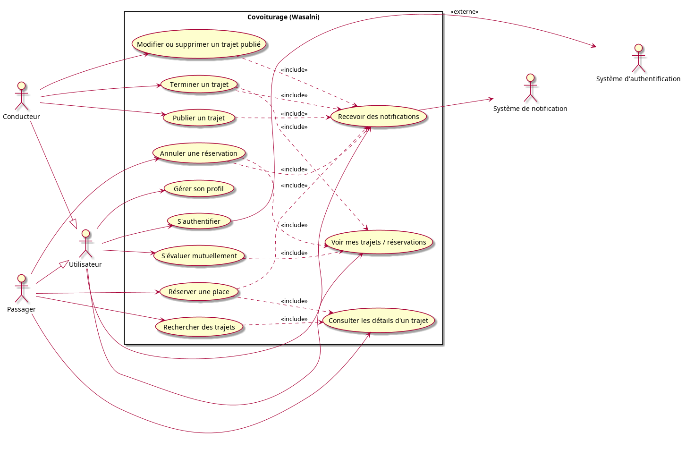

# Élaboration des cas d'utilisation - Wasalni

Élaboration des cas d'utilisation listés dans [vision.md](vision.md).

Source : [docs/uml/usecases.puml](uml/usecases.puml).

## Décisions

- L'implémentation UC9 est détaillée dans [uc9-edit-ride.md](uc9-edit-ride.md).

- L'annulation par le passager (UC5) est possible jusqu'à `departure - X`.
- `X` est choisi par le conducteur lors de la publication (UC1) et stocké avec le trajet.
- Le conducteur marque le trajet comme terminé (UC11) ; cela débloque les évaluations (UC6).
- Conducteur et passager sont des rôles qu'un même utilisateur peut occuper sur des trajets différents.
- Deux systèmes externes : le **système d'authentification** fournit l'identité, le **système de notification** livre les messages.
- L'interface utilisateur est entièrement en français ; ce document et les libellés du diagramme le sont aussi.

## Acteurs

| Acteur | Type | Rôle |
|---|---|---|
| Utilisateur | abstrait | identité commune : profil, évaluations, historique |
| Conducteur | principal (`Utilisateur`) | publie, modifie, supprime et termine des trajets |
| Passager | principal (`Utilisateur`) | recherche, réserve, annule, évalue |
| Système d'authentification | secondaire (intégré depuis UC13) | délivre les sessions ; le service porte les comptes (ADR 0011) |
| Système de notification | secondaire (externe) | livre les messages aux deux parties |

## Liste des cas d'utilisation

| ID | Nom | Acteur principal |
|---|---|---|
| UC1 | Publier un trajet | Conducteur |
| UC2 | Rechercher des trajets | Passager |
| UC3 | Réserver une place | Passager |
| UC5 | Annuler une réservation | Passager |
| UC6 | S'évaluer mutuellement | Utilisateur |
| UC7 | Consulter les détails d'un trajet | Passager |
| UC8 | Gérer son profil | Utilisateur |
| UC9 | Modifier ou supprimer un trajet publié | Conducteur |
| UC10 | Voir mes trajets / réservations | Utilisateur |
| UC11 | Terminer un trajet | Conducteur |
| UC12 | Recevoir des notifications | Utilisateur |
| UC13 | S'authentifier | Utilisateur |

---

## UC1 - Publier un trajet

- **Acteur :** Conducteur. **Inclut :** UC12 (notification).
- **Préconditions :** l'utilisateur est identifié (jeton de session) et agit comme conducteur.
- **Postconditions :** le trajet existe avec origine, destination, heure de départ, places, prix et délai `X` ; le conducteur en est le propriétaire.
- **Scénario nominal :**
  1. Le conducteur soumet l'origine, la destination, l'heure de départ, les places, le prix et `X`.
  2. Le système valide les champs et crée le trajet avec toutes les places disponibles.
  3. Le système répond `201 Created` avec le trajet.
- **Scénarios alternatifs :** A1 aucune identité -> `401` ; A2 champs invalides (départ passé, places < 1, `X` < 0) -> `400`.
- **Règles métier :** `X` est stocké sur le trajet ; l'échéance est `departure - X`. `X = 0` permet d'annuler jusqu'au départ.
- Feuille détaillée : [uc1-publish-ride.md](uc1-publish-ride.md). Séquence : [uml/uc1-sequence.puml](uml/uc1-sequence.puml).

## UC2 - Rechercher des trajets

- **Acteur :** Passager. Aucune précondition.
- **Scénario nominal :**
  1. Le passager soumet origine, destination et une date facultative.
  2. Le système renvoie les trajets avec places disponibles, prix et conducteur.
  3. Le passager choisit un résultat (UC7).
- **Scénarios alternatifs :** aucun résultat -> liste vide.
- **Règles métier :** les trajets supprimés ou terminés ne sont pas listés ; tri par heure de départ.

## UC3 - Réserver une place

- **Acteur :** Passager. **Inclut :** UC12 (notification).
- **Préconditions :** le trajet existe (UC1) et a une place libre.
- **Postconditions :** une place est retenue et une réservation existe.
- **Scénario nominal :**
  1. Le passager envoie `POST /rides/{id}/bookings`.
  2. Le système vérifie le trajet et que le passager n'est pas le conducteur.
  3. Le système décrémente `seats_available` et crée la réservation en une transaction.
  4. Le système notifie les deux parties et répond `201 Created`.

- **Scénarios alternatifs :** A1 aucune identité -> `401` ; A2 trajet inconnu -> `404` ; A3 le conducteur réserve son trajet -> `400` ; A4 plus de place (même en concurrence) -> `409`, rien n'est écrit ; A5 réservation active déjà présente -> `409`.
- **Règles métier :** `seats_available` ne descend jamais sous 0 (`CHECK` SQL + `UPDATE` conditionnel) ; une réservation active par passager et par trajet (index unique partiel). Feuille détaillée : [uc3-book-seat.md](uc3-book-seat.md).

## UC5 - Annuler une réservation

Fiche d'implémentation : [uc5-cancel-booking.md](uc5-cancel-booking.md).

- **Acteur :** Passager. **Inclut :** UC12 (notification).
- **Préconditions :** le passager a une réservation active.
- **Postconditions :** la réservation est annulée et la place est libre.
- **Scénario nominal :**
  1. Le passager choisit une réservation (UC10) et demande l'annulation.
  2. Le système vérifie `now < departure - X` avec le `X` du trajet.
  3. Le système annule et incrémente `seats_available` en une transaction.
  4. Le système notifie les deux parties.
- **Scénarios alternatifs :** A1 réservation inconnue ou non possédée -> `404` ; A2 déjà annulée -> `409` ; A3 échéance dépassée -> `409`.
- **Règles métier :** `X` est lu sur le trajet, jamais dans la requête.

## UC6 - S'évaluer mutuellement

- **Acteur :** Utilisateur (les deux rôles).
- **Préconditions :** le trajet est terminé (UC11) et l'évaluateur y a participé.
- **Postconditions :** une évaluation est enregistrée pour l'autre partie.
- **Scénario nominal :**
  1. L'utilisateur ouvre un trajet terminé depuis UC10.
  2. Il soumet une note (1 à 5) et un commentaire facultatif.
  3. Le système enregistre et affiche la moyenne mise à jour sur les profils.
- **Scénarios alternatifs :** A1 trajet non terminé -> `409` ; A2 non participant -> `403` ; A3 évaluation déjà faite -> `409`.
- **Règles métier :** une évaluation par couple et par trajet ; conducteur et passagers évaluent indépendamment ; aucune modification après dépôt.

## UC7 - Consulter les détails d'un trajet

- **Acteur :** Passager. **Préconditions :** le trajet existe.
- **Scénario nominal :**
  1. Le passager sélectionne un trajet depuis UC2.
  2. Le système renvoie l'heure et le lieu de départ, le lieu d'arrivée, ainsi que le nom, le sexe, l'âge, la photo de profil et la note moyenne du conducteur.
- **Scénarios alternatifs :** A1 trajet supprimé ou terminé -> `404`.
- **Règles métier :** lecture seule ; les informations du conducteur viennent de UC8 et la note de UC6.

## UC8 - Gérer son profil

- **Acteur :** Utilisateur identifié. **Postconditions :** le profil contient nom, âge, sexe et photo.
- **Scénario nominal :**
  1. L'utilisateur soumet (ou modifie) nom, âge, sexe et une photo facultative.
  2. Le système valide et enregistre le profil, puis répond `200`/`201`.
- **Scénarios alternatifs :** A1 aucune identité -> `401` ; A2 âge invalide ou nom manquant -> `400` ; A3 photo trop volumineuse -> `400`.
- **Règles métier :** chacun ne modifie que son profil ; nom et âge requis, sexe et photo facultatifs ; le profil est visible dans UC7.

## UC9 - Modifier ou supprimer un trajet publié

- **Acteur :** Conducteur. **Inclut :** UC12 (notification).
- **Préconditions :** le trajet existe et appartient au conducteur.
- **Scénario nominal :**
  1. Le conducteur ouvre un de ses trajets (UC10), modifie des champs ou demande la suppression.
  2. Le système vérifie la propriété et que le nouveau nombre de places n'est pas inférieur aux réservations.
  3. Le système enregistre, ou supprime le trajet et annule ses réservations.
  4. Le système notifie les passagers concernés.
- **Scénarios alternatifs :** A1 non propriétaire -> `403` ; A2 trajet inconnu -> `404` ; A3 places insuffisantes -> `409` ; A4 trajet terminé -> `409`.
- **Règles métier :** modifier `X` décale l'échéance de toutes les réservations.

## UC10 - Voir mes trajets / réservations

- **Acteur :** Utilisateur identifié.
- **Scénario nominal :**
  1. L'utilisateur demande ses trajets (`GET /me/rides`) et ses réservations (`GET /me/bookings`) avec son jeton.
  2. Le système renvoie les trajets qu'il conduit (tous statuts, supprimés exclus, triés par départ croissant) et les
     réservations qu'il détient (les deux états, de la plus récente à la plus ancienne, chacune avec son trajet).
  3. Il peut ensuite suivre UC5, UC9, UC11 ou UC6.
- **Scénarios alternatifs :** A1 aucune identité ou jeton expiré -> `401` ; A2 rien -> `200` avec `[]` ; A3 trajet
  supprimé par UC9 -> absent de `GET /me/rides`, et la réservation annulée par cette suppression apparaît avec
  `"ride": null`.
- **Règles métier :** les trajets à venir et passés sont renvoyés ; chaque liste ne contient que les données de
  l'appelant, l'identité venant de la session et jamais d'un paramètre ; les évaluations ne sont proposées que sur les
  trajets terminés.

## UC11 - Terminer un trajet

Fiche d'implémentation : [uc11-complete-ride.md](uc11-complete-ride.md).

- **Acteur :** Conducteur. **Inclut :** UC12 (notification).
- **Préconditions :** le trajet existe, appartient au conducteur et n'est pas déjà terminé.
- **Scénario nominal :**
  1. Le conducteur ouvre un de ses trajets (UC10) et le marque comme terminé.
  2. Le système enregistre la fin et notifie les passagers, puis répond `200`.
- **Scénarios alternatifs :** A1 non propriétaire -> `403` ; A2 trajet inconnu -> `404` ; A3 déjà terminé -> `409`.
- **Règles métier :** action définitive et irréversible ; ne modifie aucun statut de réservation ; seule condition d'entrée de UC6.

## UC12 - Recevoir des notifications

- **Acteur :** Utilisateur. **Secondaire :** Système de notification (externe).
- **Préconditions :** un événement a eu lieu sur un trajet de l'utilisateur (UC1, UC3, UC5, UC9, UC11).
- **Postconditions :** la notification a été transmise au système externe.
- **Scénario nominal :**
  1. Un trajet ou une réservation change de statut.
  2. Le système envoie le destinataire, le message et le type d'événement au système de notification.
  3. Celui-ci livre le message à l'utilisateur.
- **Scénarios alternatifs :** A1 livraison échouée -> l'échec est journalisé, l'action métier réussit.
- **Règles métier :** livraison au mieux, jamais de rollback ; le contenu n'est pas stocké.

## UC13 - S'authentifier

- **Acteur :** Utilisateur. **Secondaire :** Système d'authentification (externe).
- **Postconditions :** l'utilisateur possède un compte et un jeton de session que l'application accepte.
- **Scénario nominal :**
  1. L'utilisateur soumet ses identifiants au système d'authentification.
  2. Celui-ci les valide et renvoie un jeton.
  3. Le client présente ce jeton dans `Authorization: Bearer …` à chaque appel.
- **Scénarios alternatifs :** A1 identifiants invalides -> `401` ; A2 identité absente ou expirée -> `401`.
- **Règles métier :** l'application stocke le mot de passe **haché** (PBKDF2-HMAC-SHA256, sel aléatoire par compte) et
  n'émet que des jetons opaques, conservés hachés en base, valables 24 h ; aucune identité n'est crue sur parole (ADR 0011).

## Points à clarifier

- Qui marque un trajet comme terminé si le conducteur ne le fait jamais (fin automatique après départ + X) ? Hors périmètre pour l'instant.
- Quels événements génèrent une notification et par quel canal (push, e-mail, SMS) : décision du système de notification externe.

